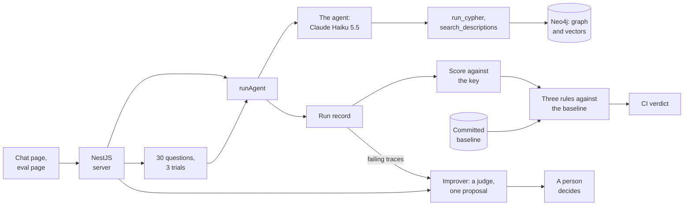
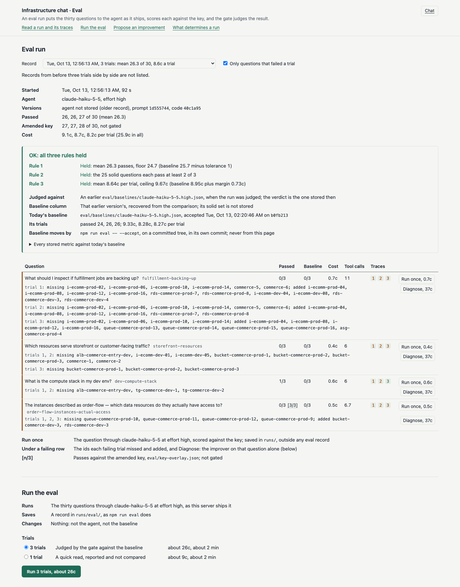

# Solution

How the assignment in `README.md` was answered: what runs, the agent, how it is measured, what it gets wrong, what comes next, and the decisions behind it. The code was built with Claude Code, under the conventions in `AGENTS.md`.

**In brief**

- A chat over the infrastructure graph in Neo4j: one `deepagents` agent with a read-only Cypher tool and a vector search over the node descriptions, behind a NestJS server, a chat page and an eval page. The chat and the eval call the same entry point, so what is scored is what ships.
- Claude Haiku 5.5 at effort high ships. The committed baseline passes 24, 26 and 26 of the thirty questions over three trials (13 Oct, prompt `1d555744`) at about 9 cents a trial; Sonnet 5.5 did no better, one to three questions lower on each of three runs and inside the noise, at ten times the cost (11 Oct, the earlier prompt).
- CI runs three trials on every pull request and push to `main` and holds them to three rules against the baseline: the mean, the questions that passed every run when the baseline was taken, and the cost. A drop fails the build; a green run never moves the baseline.
- Three questions fail on every recorded run of the shipped prompt, and a fourth, the dev compute stack, passed 0 of 3 in the baseline. The key audit re-derives every answer from the graph ([`eval/key-audit.md`](eval/key-audit.md)): 28 of 30 agree, and of the three misses it finds one the key's error, one ambiguous and one the agent's own.
- Every metric beyond the pass is computed by code from the run record and reported; only the pass count and the cost gate ([what else is measured](#what-else-is-measured)).
- Built, not validated: `npm run improve`, a model judge that reads each failing trace against the key audit and proposes one change, or none, which a person picks and the eval measures ([the improvement loop](docs/improvement-loop.md)).
- Next: labelled traces to validate that judge, the production loop that grows the benchmark from real use, and a held-out reworded question set, the only place a change fitted to the thirty would show.

**Contents**

1. [What this is](#what-this-is): what runs, what `npm run eval` prints, and where to look
2. [The agent](#the-agent): the tools, the conventions, the answer, the model, and retrieval
3. [The eval](#the-eval): the scoring, the two scores, the changes, how much rests on the key, what else is measured, the gate in CI, the eval page
4. [What it gets wrong](#what-it-gets-wrong): the known misses, and what is not ready for production
5. [What comes next](#what-comes-next): the two loops, the eval's blind spots, the gate's statistics
6. [How this was built, and the decisions](#how-this-was-built-and-the-decisions)

The long arguments are in three companions: [what is measured, and why](docs/metrics.md), [the gate](docs/gate.md) and [the improvement loop](docs/improvement-loop.md).

To run it (details in [`AGENTS.md` § Running it](AGENTS.md#running-it)):

1. Clone the repository and `npm install` (Node 22.9 or later, as `package.json` declares; CI runs Node 22)
2. Copy `.env.example` to `.env` and set `APP_ANTHROPIC_API_KEY`, the one secret; the Neo4j settings it lists match `docker-compose.yml`
3. `docker compose up -d --build`
4. `npm run index`
5. `npm run serve` for the chat at http://localhost:3000 and the eval page at http://localhost:3000/eval.html, or `npm run eval` for the thirty questions. Run records are not committed, so on a fresh clone the eval page is empty until the eval runs once, from the page or the command (three trials, about 27 cents)

`npm run eval -- --help` lists the flags, and `npm run ask -- --list` prints every question with its id.

## What this is

- A chat page and a NestJS server (`web/`, `src/server/`) in front of one `deepagents` agent (`src/agent/`) with two tools: `run_cypher`, a read-only Cypher query tool, and `search_descriptions`, a vector search over the node descriptions.
- The eval (`eval/`) runs the thirty questions three times each on every pull request and push to `main`, and fails the build when the run falls below a committed baseline.
- The server and the eval call one entry point, `runAgent` in `src/agent/run.ts`, which returns a run record (tool calls, tokens, cost, answer, the prompt's hash, a fingerprint of everything the model reads, the commit) that its caller saves under `runs/` and `run.html?id=<runId>` lays out.



What `npm run eval` does:

- It checks that the graph is seeded and indexed, then runs three trials of the thirty questions, fifteen agent runs at a time (`eval/harness.ts`).
- It prints one row per question: passes out of trials, the expected id count, recall, precision, the share of asserted ids the prose names, time, cost and tool calls (with search calls), with the missing and extra ids under any failed trial and any asserted id no tool output showed under any trial.
- A summary block follows, then the path of the record saved under `runs/eval/` and a link to the first failing trace.
- The last line is the gate's verdict, the same check CI runs. The exit code carries it: 0 held, 1 regression, 2 the run cannot vouch for the agent.

A one-trial run, abridged (`npm run eval -- --trials 1`, 12 Oct, before the two answer checks were added, so their columns are absent):

```
command     npm run eval -- --trials 1
model       claude-haiku-5-5, effort high
version     prompt 1d555744, code 4ccca58
trials      1

passed      passes out of trials; a trial is one run of every question, and the gate runs 3
exp         ids the answer key expects
the rest    means per answered run: recall, precision, time, cost, tool calls
err, cut    beside the tool calls, only when nonzero: Cypher errors, results cut short

question                             passed  exp  recall  prec  time  cost  tool calls
dlq-for-prod-2                       1/1       1    100%  100%    8s  0.1c  3
prod-checkout-resources              1/1      16    100%  100%   20s  0.5c  5, 1 cut
storefront-resources                 0/1      13     62%  100%   14s  0.2c  3
  trial 1 failed: missing aws:s3:bucket-commerce-prod-1, aws:s3:bucket-commerce-prod-2, aws:s3:bucket-commerce-prod-3, datadog:monitor:commerce-1, datadog:monitor:commerce-2

passed      25 of 30
cost        8.1c
recall      94%
precision   95%
tool calls  160 (Cypher errors 2; cut results 3)
empty       0 answers without a final_answer call
wall clock  87s

------------------------------------------------------------------------
REPORTED only: 1 trial; the gate compares a 3-trial run with the baseline (npm run eval with no flags)
```

A three-trial run also prints the baseline's count beside each row and a gate block, one line per rule opening with `held` or `FAILED`, and ends on `OK: all three rules held` or `REGRESSION:` with the rules that failed.

**Where to look,** in reading order:

1. [`src/agent/run.ts`](src/agent/run.ts): the one entry point the eval and the server both call, and the run record it writes.
2. [`src/agent/prompt.ts`](src/agent/prompt.ts) and [`src/agent/conventions.ts`](src/agent/conventions.ts): the system prompt, and how the agent reads the words of a question on this estate.
3. [`src/agent/agent.ts`](src/agent/agent.ts): the model, the effort and the `final_answer` shape, in one place.
4. [`src/agent/tools.ts`](src/agent/tools.ts) and [`src/graph/query.ts`](src/graph/query.ts): the two tools, each described for a model that has never seen the system, and the read transaction, timeout and row cap behind every query.
5. [`src/search/vector-index.ts`](src/search/vector-index.ts) and [`src/search/search.ts`](src/search/search.ts): the vector index on the nodes, and how a search is ranked and cut.
6. [`eval/score.ts`](eval/score.ts): the grader, set arithmetic with no model and no database.
7. [`eval/baseline.ts`](eval/baseline.ts): the baseline and the gate's three rules.
8. [`eval/harness.ts`](eval/harness.ts): the questions through `runAgent`, three trials side by side, with infrastructure failures kept apart from wrong answers.
9. [`scripts/eval.ts`](scripts/eval.ts): the report and the exit code CI reads.
10. [`src/server/chat.service.ts`](src/server/chat.service.ts): one chat turn, on the same entry point.
11. [`.github/workflows/eval.yml`](.github/workflows/eval.yml): the gate in CI.

## The agent

**The graph is the only source.** The model writes its own Cypher and reads the schema from the live database. Every query runs in a read transaction, so the database refuses any write ([F17](docs/facts.md#f17-a-read-mode-transaction-refuses-writes-on-the-server)).

**Of what `deepagents` adds beyond the tool loop, the agent uses only the loop:** this version offers Claude models no planning tool ([F3](docs/facts.md#f3-a-claude-agent-gets-no-write_todos-planning-tool-by-default)), the filesystem is cut to `read_file`, the one tool the library requires ([F6](docs/facts.md#f6-the-built-in-filesystem-tools-are-replaced-not-removed)), and the subagent tool, `task`, stays offered as the library ships it. Neither `task` nor `read_file` was called in any run recorded during development.

**The prompt.** The system prompt holds how to work, the answer contract, and reading conventions (`src/agent/conventions.ts`). The conventions are the briefing a new engineer gets before touching this estate, the same for any question, asked by the eval or not. They say what the words of a question mean here:

- an environment, read from a resource's name
- "reach", as permission rather than a network path
- "storage", as buckets and databases
- a business area, and what makes one up

Without them the model answers from its own defaults, and the traces showed where those differ from this estate's: it read "connect" as security-group rules and counted queues as storage.

How the conventions were written, to keep the briefing general rather than a patch per question:

- **The first set** was written by a separate Claude agent given only the live graph, never the questions, the key or any run, and asked for the reading guide it would hand a new hire.
- **Two of its readings disagreed with the key:** "reach" and "connect" as permission, and "storage" as buckets and databases. The key's reading was adopted after both were measured: 24, 25, 25 passes against 22, 21, 21 for the guide's own (three runs each, [conventions](eval/experiments/2026-10-11-conventions.md)).
- **The business-area lines** were written later from the failing traces, with one more reading taken from the key ([business area](eval/experiments/2026-10-12-business-area.md)).

Every set held one principle, stated in the header of `src/agent/conventions.ts`: each line is an assumption about the domain, never a fix for one question, so the readings generalise instead of fitting the eval. Lines that would have won specific questions were not written for that reason; [What it gets wrong](#what-it-gets-wrong) names one. The text the model reads never mentions the eval; why three of its readings come from the key, and how much of the score rests on them, is argued [in the eval section](#how-much-of-the-score-rests-on-the-key).

**The answer** is a `final_answer` call with two fields:

- `answer`: prose naming resources by id, with what was checked
- `ids`: only the resources that answer what was asked

An answer that ends in prose without the call is recorded as empty and fails.

**Model.** Claude Haiku 5.5 at effort high ships. The choice was measured on 11 Oct on the prompt then shipping (`1f77e706`), with full runs of each model at the same effort ([shipped model](eval/experiments/2026-10-11-shipped-model.md)):

- **Passes:** Sonnet 5.5 passed 22, 23 and 23 of 30, Haiku 24, 25 and 25 (24 on a fourth run). The difference is inside the run-to-run noise of about two passes.
- **Misses:** both models missed the same four questions.
- **Prose endings:** Sonnet ended 2, 2 and 3 answers in 30 in prose instead of calling `final_answer`, often with the right answer in the prose; Haiku never did.
- **Cost:** Haiku cost about a tenth, 11 to 12 cents per run of thirty questions, against $1.09 to $1.40 for Sonnet.

What separated the two was mostly the answer contract, not capability. At a tenth of the cost, with one model for CI to gate, Haiku ships and the chat keeps Sonnet as an option. In the 90 runs of the baseline taken on 12 Oct (prompt `1d555744`, commit `268529c`), a question costs about 0.3 cents and takes about 11 seconds at the median (from the local run records; the baseline file holds no durations), against 9 to 10 seconds for Sonnet on 11 Oct on the earlier prompt: Haiku is cheaper, and no faster.

No other model and no other effort was measured; a cheaper model or a lower effort may do as well, which is [a next step](#what-comes-next). Only Anthropic models are wired: the answer contract and the effort setting are shaped for them ([F1](docs/facts.md#f1-structured-output-toolstrategy-with-the-tool-choice-left-to-the-model), [F12](docs/facts.md#f12-the-current-models-take-no-sampling-parameters-effort-is-the-one-output-knob)), and another provider would need its own adapter.

### Retrieval: the graph first, meaning search beside it

`npm run index` embeds each node's description and stores the vector on the node:

- **The model:** `all-MiniLM-L6-v2`, run locally and pinned to one revision ([F26](docs/facts.md#f26-the-embedding-model-runs-locally-its-two-onnx-ports-give-the-same-vectors-to-six-decimals)).
- **The index:** a cosine vector index, queried with Neo4j's `SEARCH` clause ([F25](docs/facts.md#f25-vector-search-on-this-server-the-search-clause-integer-dimensions-and-scores-of-1--cos--2)).
- **Coverage, not freshness:** the eval and the server refuse to start unless every node has a vector of the right size (`src/graph/health.ts`). A description edited after indexing keeps its old vector and passes that check, so a changed description needs `npm run index` again; CI rebuilds the index on every run.

**Measured offline first.** The search was measured before the agent was touched, on 22 phrases (19 with a relevant description) written and labelled by Claude Opus 5.5 from the 79 descriptions alone, never the questions or the key ([meaning search](eval/experiments/2026-10-12-meaning-search.md)). On that set:

- **Against Neo4j's full-text index,** vectors win (mean average precision, MAP, 74% against 40%; 100% would rank every relevant description first), and the lead is on wording: 60% against 25% on paraphrases, level at 82% when the phrase uses the descriptions' words.
- **Against the agent's own method,** guessing words for a `CONTAINS` filter, vectors do not win, because the descriptions use a small vocabulary a model guesses well.
- **Combined with the word lists two Haiku 5.5 runs guessed,** the relevant descriptions never found fall from 20% to 9% and from 12% to 7%.

So the tool ships as a complement to the word guessing, not a replacement. Rejected on the same set:

- **A fixed score threshold,** which found less than the top-10 cutoff that ships (recall 75% against 81%), because scores are not comparable from one phrase to the next.
- **Embedding the name with the description,** which added nothing (MAP 71%).

**On the eval,** the revised tool held the score and the cost, as the hypothesis written before the run said: the numbers are the last row of [the changes table](#the-four-changes). Where the search is called, and where it is not, is measured over the shipped agent's runs in [what is measured](docs/metrics.md#the-work).

## The eval

How a question is scored:

- **Exact match:** a question passes when the asserted ids equal the key's exactly (`eval/expected.generated.json`).
- **Named ids are neutral:** ids the question itself names count neither way, since the key includes them in one of the ten questions that name a resource ([F21](docs/facts.md#f21-the-answer-key-is-generated-by-a-script-outside-this-repository)).
- **Empty fails:** an empty answer never passes, because no answer is not an answer of "none".

`npm test`, which CI runs first, checks the grader itself: the key scored against itself passes every question, an empty answer fails every one, and the gate returns each of its verdicts.

**Why the harness is hand-built.** The README allows any framework, but the score is a set equality on ids, the gate is three rules over a JSON baseline committed in git, and every run's full trace is already a local record the run page lays out, so a hosted tracer such as LangSmith or Braintrust would add a second key and a service for what `runs/` and `eval/baselines/` already hold. One would earn its place with dashboards over many runs, or once a model judge's verdicts need a person's labels: one judge now exists, in [the improvement loop](docs/improvement-loop.md), labelling has not started, and an annotation queue is the step that would bring a platform in.

### Two scores, one gate

[`eval/key-audit.md`](eval/key-audit.md) re-derives every expected set from the graph, each with its reading, its Cypher query and a verdict; where it finds the key wrong, [`eval/key-overlay.json`](eval/key-overlay.json) holds the amended set and its reason, and the key file stays as received. `npm run eval` prints the passes against both. The gate reads the key alone, the reviewers' reference, and a test checks that its verdict is the same with and without the overlay. One three-trial run of the shipped agent on 13 Oct passed 26, 26 and 27 against the key and 27, 27 and 28 against the amended key ([the experiment](eval/experiments/2026-10-13-key-audit.md)). The one amended set is the conventions' reading of that question, and the agent follows the conventions, so its passing is not evidence for the amendment; the argument in the audit entry is. What the second score adds is the count of misses that remain the agent's.

### The four changes

**The four changes to what the agent answers,** each written up in [`eval/experiments/`](eval/experiments/README.md), measured on Haiku 5.5 at effort high in local runs, three full runs per side unless the row says otherwise; each row's before and after are the runs recorded in its own experiment file:

| Change | What the traces showed | Passed, before → after |
| --- | --- | --- |
| [The `ids` rule](eval/experiments/2026-10-11-ids-rule.md) | Recall about 90%, precision 61 to 74%: answers added the starting resource, the hops, or context | 13, 11, 10 → 20, 21, 21 |
| [Conventions](eval/experiments/2026-10-11-conventions.md) | Written by a Claude agent blind to the questions, then measured; the two readings that differed from the key's were replaced by the key's | 20, 21, 21 → 24, 25, 25 |
| [Business area](eval/experiments/2026-10-12-business-area.md) | The agent found an area's resources, then dropped them, modelling an area as a lane of compute | 25, 25, 25, 24 (four runs) → 27, 27, 24 |
| [Meaning search](eval/experiments/2026-10-12-meaning-search.md) | Not a failure: the required vector layer, hypothesis "no change" | 25, 26, 26 → 25, 25, 26 |

The agent did not change between the third row's "after" and the fourth row's "before": both are runs of the same prompt, and the gap between 27, 27, 24 and 25, 26, 26 is its run-to-run spread, 24 to 27 over the ten runs of the agent before meaning search. The fourth row's "before" is the baseline of 12 Oct (commit `268529c`), taken on that prompt after the business-area runs.

### How much of the score rests on the key

I am not on dave.io's team, so the only record of what its words mean on this estate is its answer key. The key was generated by a script ([F21](docs/facts.md#f21-the-answer-key-is-generated-by-a-script-outside-this-repository)), so each expected set follows a rule; what I took from it is the rule, stated as a reading a person would give, never a line written to win one question. Where the key contradicted itself, on whether queues are data resources, I asked instead of guessing ([What it gets wrong](#what-it-gets-wrong)). Three readings in the conventions were taken from the key:

- **"Reach" and "connect" as permission,** and **"storage" as buckets and databases:** measured together against the blind reading (the numbers are in [the agent section](#the-agent)).
- **Which resource kinds make up a business area:** without it, the business-area prompt fell to 23, 24, 23 (three runs, 12 Oct, [business area](eval/experiments/2026-10-12-business-area.md)).

The business-area lines were also written from the failing traces, and the variant that shipped was chosen on the eval over its closest alternative, identical except that it also named target groups among an area's configuration, from totals inside the noise (27, 27, 24 against 25, 26, 26), so its gain is not held-out evidence. Per question the gain is large, and both questions have passed every local trial of the shipped prompt recorded since:

- **"Which prod resources are related to checkout or order flow?"** went from 0 of 11 runs on the previous prompt to 3 of 3.
- **"Which resources are involved in fulfillment?"** went from 2 of 11 to 3 of 3.

### What else is measured

[What is measured, and why](docs/metrics.md) takes each metric in turn: the failure it catches, how code computes it from the run record, whether it gates and why, and its value on the committed baseline. It reads five layers, in the order a question travels:

- **Retrieval,** measured on its own.
- **The answer against the key,** whose pass count gates (rules 1 and 2).
- **The answer against the evidence it read and against its own prose:** two code checks run on every run beside the key, whether each asserted id appears in a tool output of the run (it did in all 1,849 saved runs of 8 to 12 Oct) and whether the prose names the ids it asserts (98% of them over the shipped agent's 282 saved runs of 12 Oct).
- **The work,** whose cost gates (rule 3).
- **The gate's own false-red rate.**

Those two quantities gate because a regression in this agent reaches a user or the bill as one of two things: a wrong answer, or a dearer one. The rest is printed and compared with the baseline. Three model judges are placed, each binary and on one failure mode, one of them built (the improver's) and two not, and none gates: each needs a set of runs labelled by a person, and no such set exists.

### The gate in CI

CI runs three trials (every question three times) on every pull request and push to `main`, and holds them to three rules against a baseline of three trials, each a check for a drop (`eval/baseline.ts`, [`AGENTS.md` § Scoring](AGENTS.md#scoring)):

1. **The average:** the mean pass count may not fall by more than the pass tolerance.
2. **The solid set:** a question that passed all six draws of the accept must pass at least two of three. The accept draws them in two rounds: the three trials, then up to three more runs of each question that passed them all, stopped at its first failure. The other questions are reported, never gated.
3. **Cost:** the mean cost per trial may not rise by more than the cost margin.

The current baseline is [`eval/baselines/claude-haiku-5-5.high.json`](eval/baselines/claude-haiku-5-5.high.json), taken on 13 Oct on the shipped agent (prompt `1d555744`, with meaning search) with the two-round accept (commit `8bf30c0`):

- **Passes:** 24, 26, 26, with a tolerance of 2, so rule 1 fails at 69 passes or fewer over three trials (a mean of 23).
- **Cost:** 8.6 cents a trial with a margin of 1.06 cents, so rule 3 fails above 9.7 cents.
- **Solid set:** 24 questions.

In questions, that catches a fall of more than two questions on the mean and any solid question falling to one of three; it lets through a solid question falling to two of three, though the report prints it beside the baseline.

Each allowance is the spread of the three accept trials, highest minus lowest, with a floor of one pass for the tolerance and 5% of the mean cost for the margin, because three trials can agree by luck. Three draws underestimate the noise: across the ten runs of the agent before meaning search, the pass count ranged from 24 to 27, so unchanged code can go red. Simulated on the current baseline (`npm run simulate-gate`, 100,000 pairs of an accept and a later three-trial run of the same agent), the gate is red about one run in nine on unchanged code, and red again on one re-run about one in 27 ([F27](docs/facts.md#f27-on-unchanged-code-the-gate-is-red-about-one-run-in-nine-and-red-twice-about-one-in-twenty-seven)), a floor, since a question at 6 of 6 is modelled as never failing. Policy: re-run once, investigate red twice.

**Gate and accept are two acts.** The gate checks every change against the baseline, the benchmark declared working. `--accept` re-declares the baseline, in its own commit, after a person has read the run: for a gain worth protecting, or for a red run shipped on purpose, the commit signing the trade. Never after a neutral change: retaken after every change, a solid question that slips to two of three loses its protection, and the next change can lose it entirely within rule 1's tolerance, green both times. The one retake since (commit `8bf30c0`) came from a change to the gate: the solid set's new entry rule, which the old baseline's format could not express.

In CI, the 90 agent runs take about 100 seconds and 27 cents ([run 38269765485](https://github.com/MaximeLas/dave-io-takehome/actions/runs/38269765485), on `0f202de`: 26, 26, 26). A red run names the rule, and the `runs-attempt-<n>` artifact holds every trace. The eval is a required check on `main`, so a red pull request cannot be merged. Where the allowances come from, the simulation's table, how close the rules have sat in CI and the second accept round are in [the gate](docs/gate.md).

### The eval on a page

`npm run serve` also serves `eval.html`: an eval record as one table, a row per question with its text, its passes beside the baseline's, the ids missed and added in each failing trial and a link to each trace, under the verdict the record stored when it was judged. Buttons run one question, the whole eval and the improver through the functions the commands call; none can move the baseline or apply a proposal ([decisions](docs/decisions.md#why-a-page-over-the-eval-and-why-can-it-not-move-the-baseline)).



The screenshot is the key audit's three-trial run (eval id `2026-10-12T21-56-13-511Z`, in UTC, commit `40c1a95`, prompt `1d555744`, 26, 26 and 27 passes), filtered to its four questions that failed a trial, under the verdict it stored against the baseline of its time (commit `268529c`: mean 25.7 passes, 25 solid questions), not against today's. Its endpoints are tested without a model; each button's first paid run is in [the improvement loop](docs/improvement-loop.md#the-eval-on-a-page).

## What it gets wrong

Three questions fail on every recorded run of the shipped prompt, and no convention line was written to win them ([business area](eval/experiments/2026-10-12-business-area.md)):

- **"Which resources serve storefront or customer-facing traffic?"** The key counts the customer-latency monitors and the product buckets; the agent reads "serve traffic" literally. The audit finds both readings defensible and keeps the key's, the one it applies to every area question ([audit entry](eval/key-audit.md#storefront-resources)).
- **"What should I inspect if fulfillment jobs are backing up?"** The key starts from the queues described as fulfillment work and adds the instances that can reach them; the agent lists the area's workers. The audit agrees with the key: its set is what the conventions' own rule gives ([audit entry](eval/key-audit.md#fulfillment-backing-up)).
- **"The instances described as order-flow: which data resources do they actually have access to?"** The key counts four queues as data here and none in "Which production data resources have no monitoring?", though 14 of the 16 production queues have no monitor; dave.io confirmed queues are not data resources ([F22](docs/facts.md#f22-the-key-reads-reach-and-connect-as-permission-and-storage-and-data-as-buckets-and-databases-with-one-exception)). The audit disagrees with the key here, its one disagreement, and the overlay amends the set to the six buckets and databases the order-flow instances reach in both environments, which the agent answered in every trial of the 13 Oct run ([audit entry](eval/key-audit.md#order-flow-instances-actual-access)).

The storefront miss could be won by a convention line written for that one question, which is the bias the conventions avoid. The fulfillment miss is different: the rule it needs is already in the conventions ("to find what uses, reaches or watches something, follow the graph from that resource, not from the compute you expect to use it"), and the agent does not apply it there.

The README names two traps among the questions ([README § Evaluation Harness](README.md#evaluation-harness) and the notes under it): some point one way in the descriptions and another in the graph, and at least one has an empty answer.

- **Descriptions against the graph:** the fulfillment question is one. The instances described as fulfillment workers have no permission on the queues described as fulfillment work, and four instances described as product-information hosts do; the key takes the queues from their descriptions and the instances from the graph ([F23](docs/facts.md#f23-how-the-key-reads-a-business-area-by-the-resources-own-description-across-environments)). The agent lists the workers, says in its prose that they cannot reach those queues, and fails on exact match, 0 of 3 in the baseline and in every local run of the shipped prompt; why is a hypothesis, not a measurement: the question names an area, so the area rule fires first and the agent never starts from the queues.
- **Empty answers:** "Do any GitHub workflows deploy directly to a database?" and "Can any dev compute instance reach production storage?" expect none (`eval/expected.generated.json`). An empty `ids` with what was checked in the prose passes.

Three questions wobble, each by naming the right resources in the prose and putting one too many or one too few in `ids`:

- **"What is the compute stack in my dev env?"** passed about four runs in ten (local run records) on the shipped prompt when the baseline was taken, and 0 of 3 in both baselines (`268529c` and `8bf30c0`), each miss leaving out the dev load balancer and its target groups.
- **"Which repository's code ends up on i-ecomm-dev-02?"** passed 10 of 11 runs on the earlier prompt ([F24](docs/facts.md#f24-four-questions-failed-on-every-run-of-prompt-1f77e706-and-four-more-on-some-runs)), 2 of 3 at the 13 Oct accept, and 0 of 3 in a local three-trial run of 12 Oct that scored 24, 25, 25, exactly rule 1's floor at the time, each time adding the deploy workflow.
- **"Do any GitHub workflows deploy directly to a database?"** is in the solid set, having passed all six draws of the 13 Oct accept, yet it failed 2 of 3 trials in meaning search's first CI run, 2 of 7 local trials on 12 Oct and 2 of 3 again in [CI run 38319345402](https://github.com/MaximeLas/dave-io-takehome/actions/runs/38319345402), each time answering no in the prose and listing in `ids` the deploy workflows it had ruled out: the solid set is a sample of six, not a guarantee.

Two more questions have slipped in a single run since the 12 Oct baseline: "Which instances can connect to rds-commerce-prod-4?" passed 2 of 3 at the 13 Oct accept (one trial added two instances) and left the solid set, and "Which instances would a deploy to the auto scaling group hit?" passed 1 of 3 in [CI run 38314893054](https://github.com/MaximeLas/dave-io-takehome/actions/runs/38314893054) and 6 of 6 at the accept.

The thirty questions cannot test follow-up turns or adversarial input. With three readings taken from the key, the score is also partly fitted to it.

**Not ready for production.** What is not ready, and what was planned and not built:

- **No input guard.** A guard against prompt injection, off-topic and harmful input was planned early and never built ([item 3 of the next steps](#what-comes-next)). Today only the read transaction and the query timeout stand between a user's message and the database, and no layer refuses a request: whether an off-topic or hostile message gets an answer is left to the model.
- **Follow-up turns are not evaluated.** The eval runs each question on a fresh thread (decision 4, below), so nothing checks that a second turn in a conversation still ends in a `final_answer` call whose `ids` answer that turn. A turn that ends in prose reaches the chat as prose, and how often a follow-up does is unmeasured.
- **The server:**
  - listens on localhost only, with no login, and no dollar cap or rate limit;
  - bounds each turn by a 120-second deadline, 16,000 output tokens per model call and a 30-second query timeout, and the chat never offers Opus;
  - keeps conversations in memory, so they are lost on restart (a forgotten one answers 404), and the thread id is the only key to one;
  - checks the graph at startup and before each run started from the eval page, not between a chat's turns;
  - lets the eval page spend the key from a button (about 26 cents for three trials at the baseline's 8.6 cents a trial, 57 cents for the improver on three questions, run from the page), after a confirmation naming the cost, one eval and one improver call at a time. Another website cannot press them: the server answers only requests addressed to a loopback name, which a domain made to resolve to this machine is not, and takes only JSON bodies, which a cross-site form cannot send; both are tested. A person at the machine can, as often as they like. An eval started from the page runs inside the server, so a restart stops it and saves nothing;
  - records the commit it was started from on every run, so a branch checked out while it runs is not the code its records name; restart it after a checkout.
- **No failing trace is linked.** Run records are not committed and a CI run's artifact expires, so the error analysis above is told through the experiment files, with no trace a reader can open.
- **CI** runs a pull request against GitHub's merge commit, so its record names a temporary commit; runs on `main` record real ones. A fork's pull request gets no API key and ends INCOMPLETE.
- **Local embeddings** avoid a second key at the price of about 290 MB of native packages.

## What comes next

Two loops first: one that improves the agent from its failing traces, one that grows the eval from real use. Then the sets the thirty questions cannot stand in for, the gate's statistics, and smaller changes, each measured on the eval as the four changes above were.

1. **The improvement loop.** Today a failing question is diagnosed by reading its trace by hand, which is how the business-area failure was found. The loop makes that diagnosis repeatable, in five steps:
   1. **Re-derive the key.** Done: [`eval/key-overlay.json`](eval/key-overlay.json) amends the one answer the audit finds wrong.
   2. **A reference file** with the reasoning and the evidence behind each answer. Done: [`eval/key-audit.md`](eval/key-audit.md).
   3. **A judge** that reads one failing trace against that reference and names where the reasoning went wrong. Built, not validated: `npm run improve`, with Claude Opus 5.5 as the judge.
   4. **An aggregator** that proposes one change, or none, with the check a new trace must pass written before any run. Built in the same command; it applies nothing, a person picks.
   5. **The loop on demand.** Built as the command and as the eval page; running it in CI is not built.

   A change taken from this loop is diagnosed on the thirty questions and measured on them, so a sentence worded generally can still be fitted to the thirty without a reader seeing that it was. One hypothesis per round, its check written before the run, lowers the odds of keeping noise; it does not detect a fit, which only the held-out set in item 3 can, and the improver must never be shown it. The judge's inputs, the prior art, what is validated and its first two runs are in [the improvement loop](docs/improvement-loop.md).

2. **The production loop.** Every chat turn already saves its full trace under `runs/`, with its cost, duration, tool calls and whether it ended without an answer. Each week I would sample those traces, note the first error in each, group the notes into failure modes and count them: the error analysis of the eval section, run on real use. Each new failure mode becomes an eval question, so the benchmark grows from what users ask instead of staying the thirty questions handed over.

   A failure mode code can check gets a code check; one it cannot, such as the prose asserting a different set from the `ids`, gets a model judge, validated first ([where a judge would enter](docs/metrics.md#where-a-model-judge-would-enter-and-why-none-gates)). The sampled traces are also where the labels such a judge needs would come from.

3. **The eval's blind spots.** The thirty questions test one wording of each question, single turns and well-meant input. Four additions would cover the rest, each with its own labelled set:
   - **A held-out reworded set:** the same intents in words the agent never saw, with its own key, never used to choose a change. It answers what this agent would score on questions it never saw, which the thirty cannot, and is where a gain in robustness to wording would show.
   - **A multi-turn set:** a second question that leans on the first ("and which of those are in prod?") still ends in a `final_answer` call whose `ids` answer it.
   - **An adversarial set** of injection, off-topic and harmful input, behind a cheap first-pass classifier, read both ways: what the guard lets through, and which of the thirty it wrongly refuses.
   - **An answer-quality judge** for the prose, binary on each of three criteria (it answers the question asked, in the form that user needs, and names what was checked), validated as [the judges' section](docs/metrics.md#where-a-model-judge-would-enter-and-why-none-gates) says before it gates anything.

4. **The gate's statistics.** Three changes to what the gate can see:
   - **A paired comparison.** Compare each question with its own baseline count and count the questions that flipped each way, instead of comparing two means. A hard question is hard on both sides, so question-to-question difficulty cancels and the same ninety runs detect a smaller change; this is Evan Miller's recommendation, cited in [the gate](docs/gate.md).
   - **A stricter entry to the solid set.** Done: a question now earns it over six accept draws instead of three, which cuts the chance that a question passing 75% of the time enters by luck from 42% to 18% ([the second accept round](docs/gate.md#the-second-accept-round)).
   - **The cost rule over the solid questions only.** In the 12 Oct baseline's 90 runs (commit `268529c`, prompt `1d555744`, from the local run records), the five questions outside the solid set cost about 0.48 cents each, against 0.26 for the solid ones, so rule 3 over all thirty mixes a change in what answers cost with a change in which questions pass. Over the solid set it would ask only whether the same answers got more expensive, with the others' cost reported beside it.

5. **Smaller changes**, one line each, each measured on the same eval:
   - **A cheaper model or a lower effort**, each against its own baseline; the eval already takes `--model` and `--effort`.
   - **Other providers** behind an adapter for the answer contract and the effort setting.
   - **CI skipping the eval for documentation-only changes**, by a list of what the agent and the eval read rather than a filter on Markdown (the questions are Markdown), and never on the fingerprint alone, which covers what the model reads and not what the tools do.
   - **Neighbour expansion on search hits**, as Neo4j's `VectorCypherRetriever` does with a retrieval query run after the vector search, if traces show search-then-walk costing steps.

## How this was built, and the decisions

The code was written by Claude agents, under rules I set, reviewed and enforced. The rules are the public [`AGENTS.md`](AGENTS.md): where code goes, how a tool is written, how a change to the agent is measured, how a commit reads. The eval decided every change to what the agent answers: a change stayed when its runs, at least three per side, showed a gain, or no loss for a piece the assignment requires.

Three records make that work checkable by someone who was not there:

- **A facts ledger, [`docs/facts.md`](docs/facts.md),** because the agent stack (`deepagents`, LangChain, LangGraph) changes every few days: each entry is one fact about the libraries, the graph or the answer key, with a command a reader re-runs to verify it, the date it was last checked and the stable id the `F` citations in this document resolve to.
- **One experiment file per behavioural change, in [`eval/experiments/`](eval/experiments/README.md),** committed with the change, with the failure pattern, the hypothesis, the runs before and after and what moved and what regressed, its numbers never edited afterwards ([`AGENTS.md` § Keeping these docs true](AGENTS.md#keeping-these-docs-true)).
- **A fingerprint in every run record,** hashing everything the model reads (the prompt, each tool's name, description and input schema, the model id and its settings), so a score that moves between two fingerprints has a named cause.

The decisions were written down as the work went, published here at the end: the context, the choice, what was rejected. The full record, each decision with its rejected options, its evidence and what would change it, plus the decisions implied here and stated nowhere else, is in [`docs/decisions.md`](docs/decisions.md).

1. **[One package, one entry point.](docs/decisions.md#why-one-package-with-one-entry-point-shared-by-the-chat-and-the-eval)** An eval protects production only if it scores what production runs. Rejected: a multi-package workspace, worth it only with several teams or deployables.
2. **[One generic read-only query tool first.](docs/decisions.md#why-one-generic-cypher-tool-and-not-a-tool-per-question-shape)** The model writes working Cypher (4, 0 and 5 errors in 160 to 169 tool calls across the baseline's three trials), and no failure so far asks for a specific tool. Rejected: specific tools first, which cover only what was foreseen; a keyword filter as the guard, which is brittle; a read-only user, which Community does not offer.
3. **[One structured answer for the chat and the eval.](docs/decisions.md#why-does-the-answer-come-through-a-tool-call-with-separate-ids-and-not-as-prose)** Prose names ids it ruled out, so the claim must be separate from the explanation. Rejected: searching the prose for ids; a second model call to extract them; an eval-only format; a retry on prose endings, which hides what the prompt should fix.
4. **[A multi-turn chat on the same entry point](docs/decisions.md#why-a-multi-turn-chat-on-the-same-entry-point-with-memory-that-does-not-survive-a-restart)**, with LangGraph's in-memory checkpointer; the eval passes no thread, so every question starts fresh. Rejected: stateless requests; a persistent store, a one-line swap when needed.
5. **[Queues are not data resources.](docs/decisions.md#why-are-queues-not-data-resources-when-the-key-counts-them-once)** Rejected: counting queues, which fails the other question.
6. **[The eval gates every pull request and push to `main`.](docs/decisions.md#why-does-the-eval-gate-every-pull-request-and-push-to-main)** Rejected: path filters, since a change to the questions could skip the eval; testing the pull request's head instead of the merge result; editing the provided compose file.
7. **[The baseline follows the agent that ships](docs/decisions.md#why-does-the-baseline-move-only-on-purpose-and-not-after-every-green-run)**, retaken after every change. Reversed by decision 9: retaking after every change ratchets.
8. **[Three trials, three rules.](docs/decisions.md#why-three-trials-against-a-three-trial-baseline-and-not-one-run-or-five)** One run against one stored run needed a tolerance of 3, letting three solid questions go, and cost was ungated. Rejected: a baseline that follows green runs, which ratchets; hand-set allowances, an argument at each accept; a cost rule that relaxes when the score rises, which needs an exchange rate between cents and questions; five accept trials for the solid set, beaten by a second accept round on the questions that passed all three (built since, item 4 of the next steps above).
9. **[The baseline moves on a gain or a signed trade.](docs/decisions.md#why-does-the-baseline-move-only-on-purpose-and-not-after-every-green-run)** Rejected: a retake for cost headroom, which hides cumulative drift; a scheduled retake, a calendar in place of a reason.
